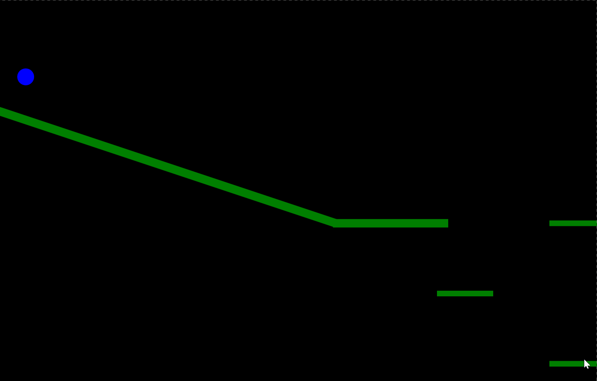

# 2D Physics Engine

A 2D rigid body physics engine written from scratch in C#, with a WPF demo.
Circles collide with each other and with thick line segments, with impulse-based
response, friction and restitution. 



## Features
- Circle bodies with mass derived from radius
- Circle vs thick line segment collision (closest point on segment, clamped)
- Circle vs circle impulse resolution with restitution and mass-weighted position correction
- Slope friction, with a restitution threshold to stop resting jitter
- Engine is a standalone class library with no WPF dependency
- xUnit tests, including momentum conservation in ball-ball collisions
- Runs over 3000 bodies at over 60 FPS

## Controls
| Key | Action |
|---|---|
| Left / Right | Move the blue ball |
| Space | Jump |
| 0 | Spawn a large ball at the cursor |
| 1 | Spawn a small ball at the cursor |

## Project structure
- `PhysicsEngine/` - engine library (`Vector2`, `Body`, `Segment`, `World`)
- `PhysicsEngine.Tests/` - xUnit tests
- `2DPhysicsEngine/` - WPF demo (rendering and input only)

## Running
Requires the .NET 10 SDK and Windows (WPF).

```
dotnet run --project 2DPhysicsEngine
dotnet test
```

## Limitations
- Circles and line segments only, no rotation
- One solver iteration per update, so tall stacks can sag
## Performance
Engine only, no rendering. Release build, [AMD Ryzen 5 3600 6-Core] 1000 x 700 world,
radius 5 to 15, 1000 steps at dt = 1/60 after a 200-step warm-up.

| Bodies | ms per update |
|---|---|
| 100 | 0.057 |
| 200 | 0.106 |
| 500 | 0.360 |
| 1000 | 1.320 |
| 2000 | 5.028 |
| 3000 | 11.017 |
| 4000 | 19.695 |

Time grows roughly with the square of the body count, because every pair is checked
each step. 3,000 bodies fit inside the 16.7 ms budget for 60 FPS and 4,000 do not.
A spatial grid would cut the number of pair checks.
